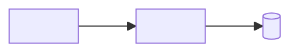

# Architecture — <project-name>

Status: <current | superseded by <adr>> · Sources: <files this was read from>

## System overview

<2-4 sentences: what runs where, in what role. Every component must exist in the tree.>

## Components

| Component | Path | Role | Depends on |
|---|---|---|---|
| <name> | <real path> | <responsibility> | <verified imports/config> |

## Data flow

<request → response for the ONE primary journey; name real functions/routes>

## Boundaries and trust

- <auth/tenancy boundary, from middleware/config actually present>

## Deployment

<targets from Dockerfile/compose/CI, ports from config; NOT RUN areas listed as open questions>

## Open questions

- <PLAUSIBLE/UNKNOWN items, never written as fact above>
